<p align="center">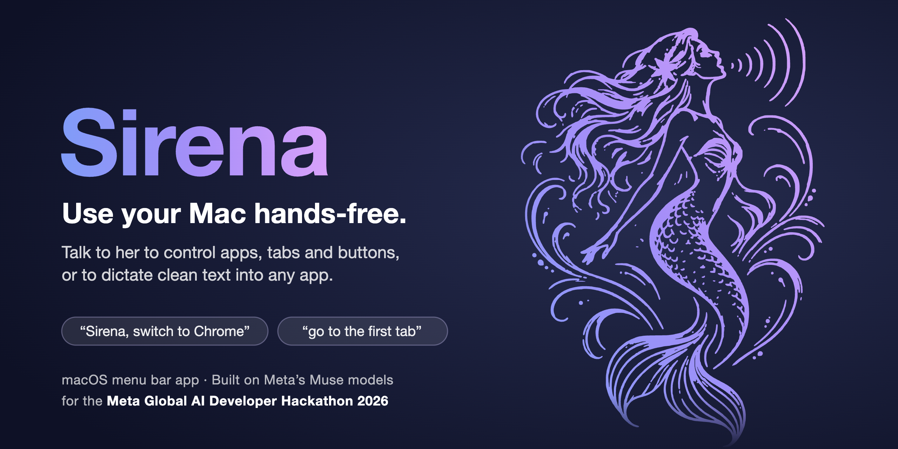</p>

## What you can say

These are only examples. Talk to her the way you would ask someone to do something on your computer for you while you watch.

| You say | Sirena does |
|---|---|
| “Sirena, switch to Chrome” | Brings Chrome to the front |
| “Go to the first tab” | Switches tab (no name needed right after a command) |
| “Sirena, click Send” | Finds the button and clicks it, after asking first |
| “Sirena, start dictating” | Types everything you say, cleaned up, until “Sirena, stop” |
| “Sirena, read the article” | Reads the page aloud, skipping menus and ads |
| “Sirena, show numbers” → “click 7” | Puts a number on every button, then clicks the one you say |
| “Sirena, copy the first paragraph” | Copies text without you selecting it |
| “Sirena, move this window to the other screen” | Moves the window to your second display |

She works in Portuguese too (“para”, “espera”, “cancela”, “sim”, “não”).

<p align="center"></p>

## Why it feels fast

Sirena reads what is on screen through the macOS Accessibility API and acts with keyboard events and
AppleScript. Most commands never need a screenshot, and the simple ones never reach a model at all.

<p align="center">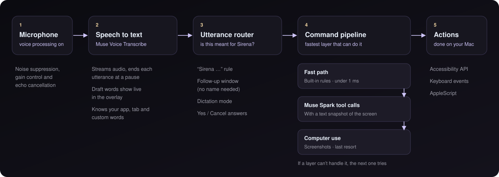</p>

Built for the Meta Global AI Developer Hackathon 2026 on Meta's models:

| Job | Model |
|---|---|
| Speech to text, live, ends each utterance at a pause | `muse-voice-transcribe-1.0` (realtime WebSocket, one-shot fallback) |
| Understanding commands, cleaning up dictation | `muse-spark-1.3` (tool calling, `reasoning_effort: minimal`) |
| Looking at the screen when all else fails | `muse-spark-1.3` computer use via the Responses API |
| Optional private mode, fully on-device | `Muse Glimmer` through Ollama / LM Studio / llama.cpp |

## Features

### Talking to Sirena

<table>
<tr>
<td align="center">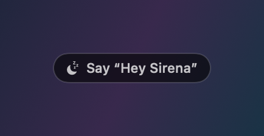<br><sub>Waiting for “Hey Sirena”</sub></td>
<td align="center">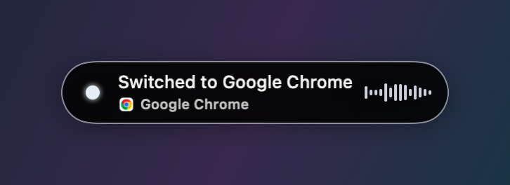<br><sub>Command done</sub></td>
<td align="center">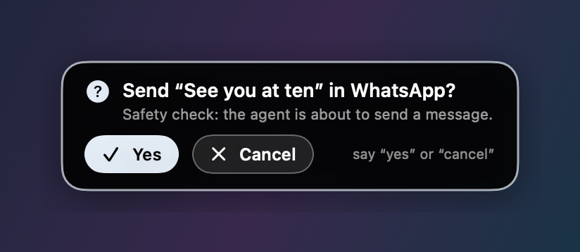<br><sub>Asking before sending</sub></td>
</tr>
<tr>
<td align="center">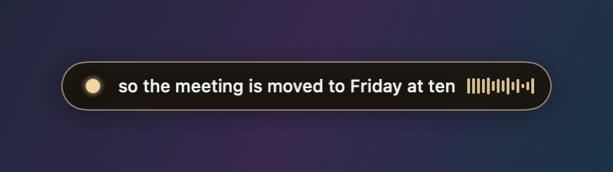<br><sub>Dictating</sub></td>
<td align="center">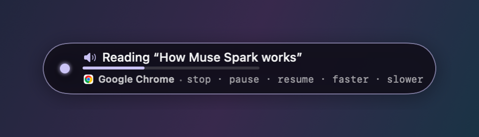<br><sub>Reading aloud</sub></td>
<td align="center">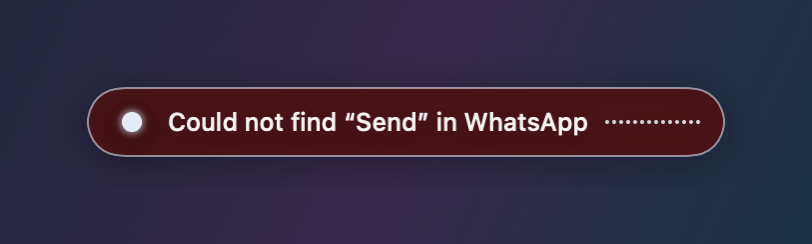<br><sub>Something went wrong</sub></td>
</tr>
</table>

* **Three listening states.** *Off*: mic closed. *Waiting*: only “Hey Sirena” wakes her. *Awake*: she listens
  to everything, and each pause ends a sentence. “Sirena, wait” or 2 minutes of silence sends her back to waiting.
* **Private while waiting.** “Hey Sirena” is heard by Apple's on-device speech recognition, so no audio leaves
  the Mac until she is awake (a lock icon shows in the pill). Falls back to streaming if on-device recognition
  is unavailable; can be turned off in the menu.
* **Say her name, then the command.** A command runs when it starts with “Sirena” (or a near miss like
  “Serena”), or has a short command right next to the name (“wait Sirena”).
* **No name needed for follow-ups.** For 8 seconds after a command (12 after “Hey Sirena”) the next one works
  without her name; a ring in the pill counts down. For 20 seconds, simple navigation (scroll, tabs, apps,
  “first link”) still works without it. “again” / “more” repeat the last command.
* **Ignores chatter.** Fillers (“okay”, “uh”), questions, half-finished commands and room conversation never
  reach the model.
* **Asks before anything risky.** Sending, deleting or closing unsaved work shows a question like
  “Send “see you at 5” in WhatsApp? Yes / Cancel” and waits for “yes” or “cancel” (Enter and Esc work too). After such a question, “Sirena, send” sends what is in the message box.

### Dictation

<p align="center"></p>

* **“Sirena, type …”** types just that text. **“Sirena, start dictating”** types everything you say until
  “Sirena, stop”, cleaned up by Muse Spark: no filler words or false starts, proper punctuation, tone fitted to the app.
* **While dictating:** “delete that”, “new line”, “undo”.
* **Lists.** “first point…”, “point two…”, “next item…” land on their own numbered lines.
* **Edits.** “make that a list”, “fix the grammar”, “separate the points with two line breaks” rewrite
  what you dictated, in place. They only touch dictated text, a selection in a text field, or a text field's contents.

### Around the screen

<p align="center">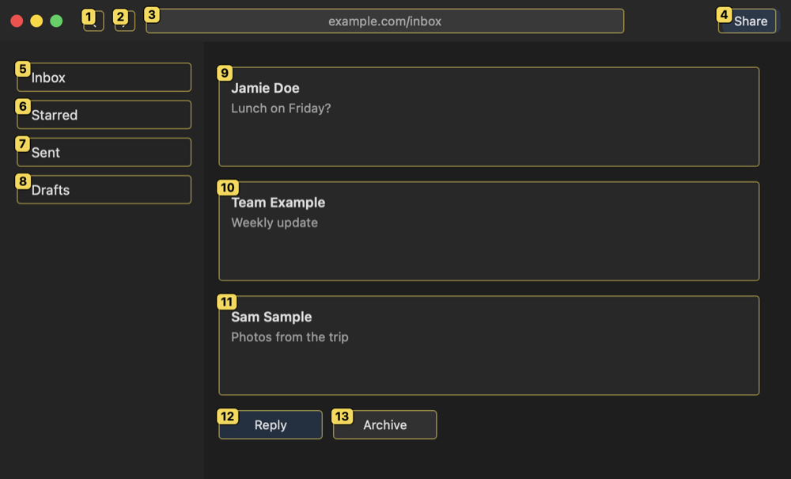</p>

* **Numbers mode.** “Sirena, show numbers” puts a badge on every clickable thing in the front window, then “click 7”.
* **Websites.** “Open YouTube / Gmail…” opens the site (or its tab if already open) in the browser you use.
  “Open Google Chrome” still opens the app. Searches go there too.
* **Search results.** “first link”, “the second one”, “open the third result” work instantly, skipping ads and
  navigation links. “Close all tabs” closes every tab in the window you see.
* **Copy without selecting.** “Copy the first paragraph / the title / the last message / the paragraph about …”
  finds the text, copies it, highlights it and shows the first words.
* **Read aloud.** “Read this” (selection), “read the article” (main text only), “read the page”. While reading,
  “stop”, “pause”, “resume”, “faster”, “slower” work without her name.
* **Several screens.** “Move this window to the other screen / the left monitor / screen 2”,
  “switch to the other screen”. The pill shows on every screen; the one with the front window is highlighted.

### Shortcuts, notes and learning

<table>
<tr>
<td align="center">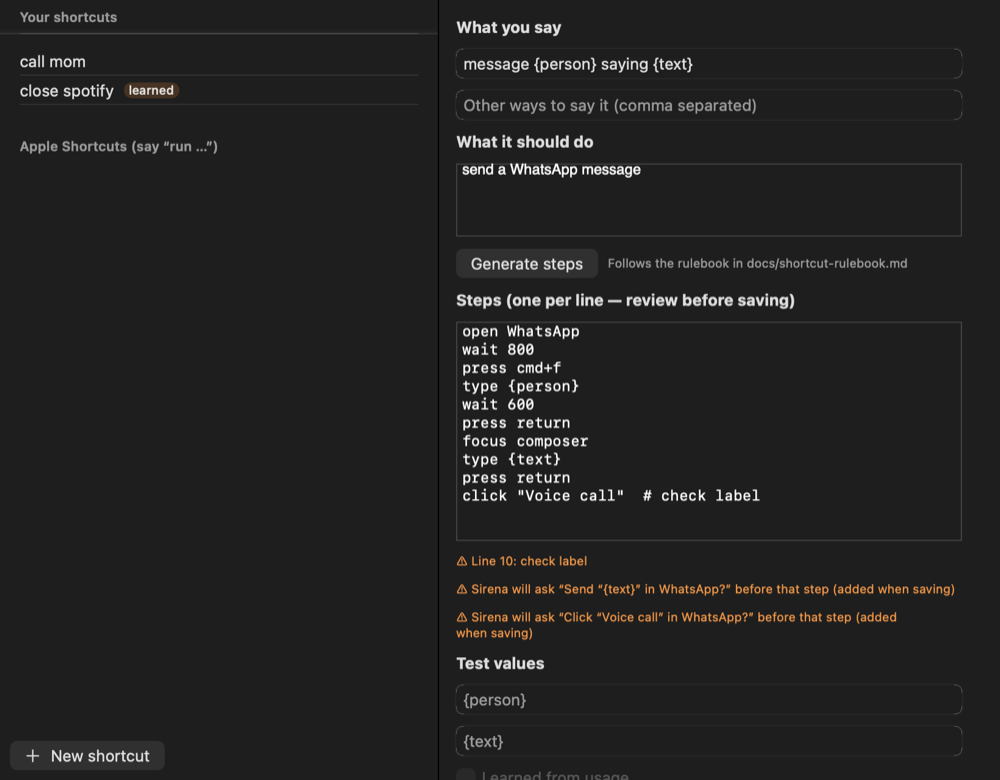<br><sub>Shortcut book</sub></td>
<td align="center">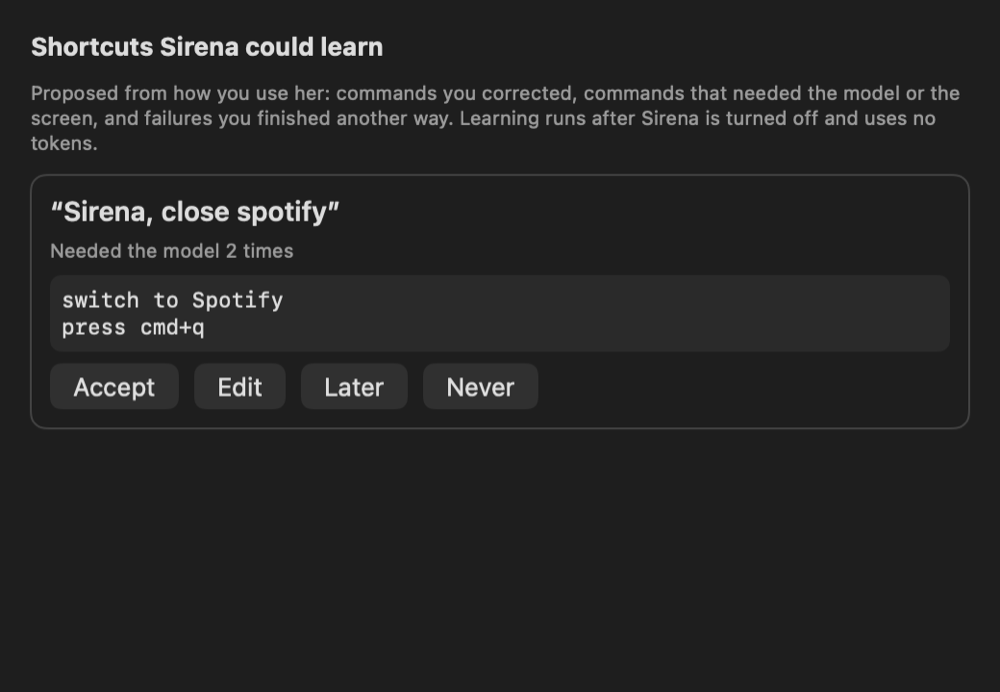<br><sub>Learned suggestions</sub></td>
</tr>
<tr>
<td align="center">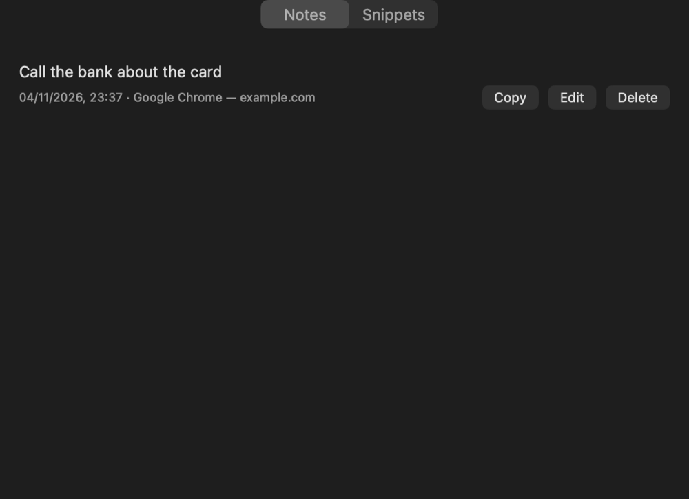<br><sub>Notes and snippets</sub></td>
<td align="center">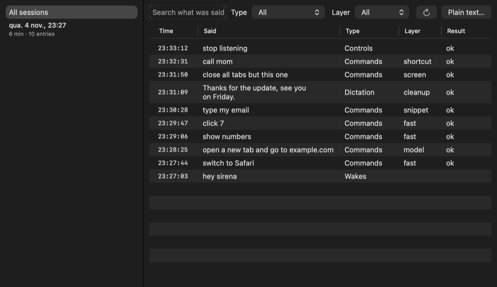<br><sub>History</sub></td>
</tr>
</table>

* **Shortcut book.** Save your own commands: “call mom” = “open WhatsApp, select Mother and call her”.
  Sirena writes the steps (following `docs/shortcut-rulebook.md`) and you check them before saving. Supports
  placeholders (“message {person} saying {text}”). Also runs your Apple Shortcuts by name.
* **Notes and snippets.** “Sirena, note …” saves a note without leaving your app; “Sirena, insert my email”
  types a saved snippet.
* **Learning.** After you turn her off, Sirena looks for commands you corrected, undid, or finished by hand,
  and suggests shortcuts for them (“Suggestions” in the menu). Local only, no tokens, at most once a day.
  “Sirena, forget that” removes a learned shortcut.

### Under the hood

* **Clean audio.** The mic goes through Apple's voice processing (noise suppression, gain control, echo
  cancellation). Sirena's own voice is filtered out while she reads.
* **Hears names right.** The recognizer is told the names of your open apps, windows, browser tabs and your
  custom words, so “switch to the Meta docs tab” comes through correctly.
* **Overlay that stays out of the way.** A floating pill that never takes focus, on every screen and Space,
  even over full-screen apps. Each screen remembers where you put it. Optional timing per step
  (speech · understanding · action).
* **History.** Every sentence, how it was handled and how long it took is saved to
  `~/Library/Application Support/Sirena/history.jsonl` (never audio). The History window has search, filters
  and “Run again”.
* **Dev mode.** A live usage panel (audio seconds, tokens, screen reads, estimated cost, latency, failures)
  and a log of every session in `~/Library/Application Support/Sirena/sessions.jsonl`.

<p align="center">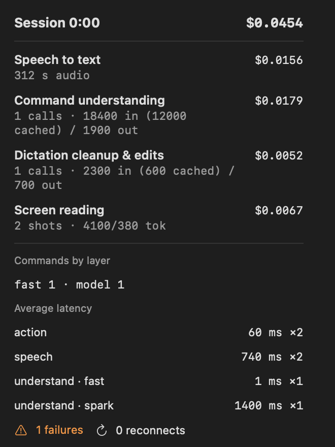</p>

<details>
<summary><b>How the screenshot fallback behaves</b></summary>

When the faster layers can't do a command, Sirena looks at the screen (“Looking at the screen…”):

* Other speech doesn't interrupt it, only “cancel”, “stop” or the answer to its question.
* Its questions name the exact thing it will act on (“Click “Mark” (the first item in the “Chats” list) in
  WhatsApp?”), never a window or page title. Harmless steps need no question.
* At most 6 steps and 30 seconds, and only for requests that say what to act on (“click consent” yes,
  “click it” no). It says so when it couldn't act.
* A question (“what's on my screen?”) gets one look and a one-line answer, never a click.
* An app, tab or site that doesn't exist (“switch to Zorbulator”) stops at “I couldn't find it” instead of a search.
* “Click X” and “focus X” search the whole window (and the app's other windows) when the first look missed it,
  e.g. a cookie banner at the bottom of a long page.
* Typing refuses with a reason when no text field is focused, and a garbled command is never typed into a field
  (“start dating” means “start dictating”).

</details>

## Requirements

* macOS 14 or later, Apple silicon or Intel.
* Xcode 15+ command line tools (Swift 5.9+).
* A Meta Model API key, in `MODEL_API_KEY` (or `SIRENA_API_KEY`) or the macOS Keychain. The app copies a key
  found in the environment into the Keychain on first launch; the setup window also accepts a pasted key.

## Build and run

```bash
export MODEL_API_KEY="LLM|…"        # or SIRENA_API_KEY
scripts/run.sh                      # builds, signs, launches build/Sirena.app
```

`scripts/build-app.sh` compiles with SwiftPM (release builds use per-file optimization: Swift 6.2's whole-module
optimizer hangs on this code base), assembles `build/Sirena.app`, and signs it with your
Apple Development identity (set `SIRENA_SIGN_IDENTITY` to pick one). Signing with the same identity every
time keeps the permission grants across rebuilds. Without an identity it falls back to an ad-hoc signature,
which makes macOS forget the permissions after each rebuild.

The app icon, `Resources/AppIcon.icns`, is made from the logo in `Resources/Logo.svg`. After changing the
logo, run `scripts/make-icon.sh` to rebuild it.

Run the tests with `swift test`.

### Developer CLI

`swift run sirena-cli …` exercises the pieces without the app (nothing is executed on your Mac):

```bash
swift run sirena-cli transcribe sample.wav          # 24 kHz mono WAV through the realtime recognizer, with events and latency
swift run sirena-cli parse "Sirena, go to the first tab" --follow-up   # router + fast-path parser
swift run sirena-cli plan "open the API reference" --no-browser        # Muse Spark plan for the current screen
swift run sirena-cli plan-demo                                         # the demo commands against a canned snapshot
swift run sirena-cli snapshot                                          # what the model would see
swift run sirena-cli simulate                                          # the whole demo script through router → pipeline → overlay, dry run
swift run sirena-cli dictate "point one, finish the overlay" "second point," "test it"   # list dictation with model cleanup
swift run sirena-cli edit "make that a list" "eggs milk bread"          # the text-edit rewrite
swift run sirena-cli compile "call mom" "open WhatsApp, select Mother and call her"     # the shortcut rulebook
swift run sirena-cli render-overlay /tmp/overlay                       # every pill state as PNG
```

Diagnostics that run inside the signed app, with its permissions:

```bash
open -n build/Sirena.app --args --selftest-wake hey_sirena.wav /tmp/wake.txt   # on-device wake word
open -n build/Sirena.app --args --selftest audio /tmp/audio.txt                 # voice-processing microphone
open -n build/Sirena.app --args --selftest context /tmp/context.txt             # snapshot, screens, article text
open -n build/Sirena.app --args --selftest tabs /tmp/tabs.txt                   # tab commands on a temporary Chrome window
open -n build/Sirena.app --args --selftest results /tmp/results.txt             # "first / second result" on a temporary Google page
open -n build/Sirena.app --args --selftest dictation /tmp/dictation.txt         # cleanup and lists with the real model, dry run
open -n build/Sirena.app --args --selftest speculation /tmp/speculation.txt     # model commands with and without the early start
open -n build/Sirena.app --args --selftest echo /tmp/echo.txt                   # plays a sentence aloud; what the recognizer hears with/without the echo gate
open -n build/Sirena.app --args --selftest players /tmp/players.txt             # apps playing sound and their output devices
open -n build/Sirena.app --args --selftest echo-sim /tmp/echo-sim.txt           # simulated music + your voice (nothing played): recognizer with/without
swift run -c release sirena-cli echo-bench                                        # echo canceller + gate speed and scores on simulated music
```

Set `SIRENA_DEBUG_DUMP=/some/dir` to write every model request and response body there.

### Permissions

The first launch opens a setup window with the status of each permission and a button to the right
System Settings pane:

* **Microphone**, required.
* **Accessibility**, required (clicks, typing, shortcuts, the element list).
* **Screen Recording**, for the screenshot fallback and to tell the Mac's own sound (music, videos) apart from
  your voice.
* **Automation**, to switch tabs in Chrome and Safari (macOS asks the first time a browser is controlled).

## Using Sirena

Click the gray dot (or the menu bar icon, or press ⌃⌥⌘S). Then:

| Say | What happens |
|---|---|
| "Sirena, switch to Chrome" / "switch to the Google page" | app, browser tab or window brought to the front |
| "Sirena, go to the first tab" · "next tab" · "tab 3" · "close tab" · "close the tabs to the right" | tabs of the app in front: browsers, VS Code (by position), Finder, Terminal, Xcode…; a browser only when the front app has no tabs |
| "Sirena, Chrome tab 2" · "switch to the second tab in VS Code" | tabs of a named app |
| "Sirena, copy the first paragraph" · "copy the paragraph about …" · "copy the paragraph that starts with …" · "copy the title" · "copy the second sentence" · "copy the last message" | copies it (and selects it on screen); "select …" / "read …" work the same way |
| "Sirena, command tab" · "alt tab" · "control c" · "alt F4" | shortcuts, Windows wording mapped to the Mac |
| "Sirena, scroll down" · "scroll up a bit" · "page down" · "scroll to the top" | scrolling (the page) |
| "Sirena, scroll down in the sidebar" · "scroll the chat up" · "scroll down here" | scrolls a part of the window: the sidebar, the list, the chat above the message box, or under the pointer |
| "Sirena, volume max" · "volume to 30 percent" · "mute" · "unmute" | output volume (volume up / down still step) |
| "Sirena, what time is it" · "what's the date" | answered on the spot, no model |
| "Sirena, learn the word kinogo" · "add Barokas to the vocabulary" | adds a custom vocabulary word for the recognizer; after hearing the same unknown word three times she suggests it |
| "Sirena, click Send" · "click the Reply button" · "focus the search field" | by accessibility label |
| "Sirena, send a message to Claude saying …" | switches, focuses the composer, types, asks before Enter |
| "Sirena, type hello world" | inserts the text |
| "Sirena, start dictating" … "Sirena, stop" | dictation mode |
| "Sirena, show numbers" … "click 4" · "hide numbers" · "show numbers on the other screen" | numbers mode: the front window (the pane with the keyboard focus first) and the topmost window on every other screen |
| "Sirena, undo" · "Sirena, cancel" | undo or stop the last action |
| "Sirena, wait" … "Hey Sirena" (or "Hey Sirena, next tab") | pause and wake (and run the command) |
| "Sirena, move this window to the other screen" · "switch to the left monitor" | several screens |
| "Sirena, make that a list" · "separate the points with two line breaks" | edit the text just dictated |
| "Sirena, read this" · "read the article" · "read the page" … "stop / pause / faster" | read aloud |
| "Sirena, note call the bank" · "Sirena, insert my email" | notes and snippets |
| "Sirena, call mom" · "Sirena, run Morning Routine" | shortcut book, Apple Shortcuts |
| "Sirena, forget that" | remove the learned shortcut that just ran |
| "Sirena, stop listening" | off |
| anything else, e.g. "Sirena, open the settings of this app and turn on dark mode" | Muse Spark plans it from the screen snapshot; the screenshot fallback takes over if needed |

Menu bar: on / wait / off, private mode (Glimmer), push-to-talk (hold right ⌥ to dictate, right ⌘ to
command), noise reduction, on-device wake word, raw dictation, latency display, larger overlay, Suggestions (N),
shortcut book, notes & snippets, custom vocabulary, command history (window and plain text), developer mode,
session log, permissions.

### Microphone

"Microphone" in the menu picks the input: Automatic (the system default) or a specific device. Some Bluetooth
earbuds appear as the default input but send only digital silence to the Mac (for example when their microphone
is connected to a phone). Sirena notices after three seconds, says "No sound from <device> — listening with
<other microphone>" and switches. Noise reduction (Apple voice processing) works only on the system default
input, so a microphone chosen this way is captured without it; set it as the input in System Settings → Sound to
get noise reduction too.

### Music and videos playing on the Mac

Apple's echo cancellation only removes sound Sirena plays herself, and it is off whenever the microphone in use
is not the system default. So while another app plays sound and Sirena listens (awake or waiting for "Hey
Sirena"), she captures what the Mac plays (ScreenCaptureKit, audio only, her own voice left out). An echo
canceller learns how the speakers reach the microphone and subtracts the music from it (about 19 dB less in
tests); what is left is compared with what is playing every 10 ms, and stretches that hold only leftover music
reach the recognizer as silence, so lyrics and videos are neither typed nor taken for commands. Your voice passes,
cleaned of most of the music, even when the music is louder than you in the microphone (12 dB louder in tests:
“Sirena, scroll down” still came through). The canceller needs a few seconds of music to learn the room; what she
learns about each microphone and speaker pair is kept. While music plays, speech reaches the recognizer about
0.15 s later. macOS shows its screen-recording indicator while this runs. "Ignore music and videos playing on this Mac" in the menu turns it off.
With headphones nothing reaches the microphone and nothing needs to be done.

### On-device wake word

While waiting, "Hey Sirena" can be detected with Apple's on-device speech recognition so no real audio leaves
the Mac (the Meta session stays open with silence, so waking is instant, and the last three seconds are replayed
so "Hey Sirena, next tab" runs in one go). This needs the Speech Recognition permission **and Dictation turned
on** in System Settings → Keyboard → Dictation; with Dictation off, macOS refuses every on-device request
("Siri and Dictation are disabled"). Sirena detects that, says so in the menu, and wakes through the normal
stream instead.

## Repository layout

```
Sources/Sirena            entry point
Sources/SirenaCore/App    menu bar, overlay panel wiring, onboarding, settings, hotkeys
Sources/SirenaCore/Speech mic capture + Muse Voice Transcribe realtime client (reconnect, keyword hot-swap) + one-shot fallback
Sources/SirenaCore/Listening  state machine, "Sirena" rule, utterance router
Sources/SirenaCore/Commands   fast-path parser, Muse Spark planner, executor, numbers mode, computer-use fallback, pipeline
Sources/SirenaCore/Context    running apps, windows, browser tabs, Accessibility tree snapshot, permissions
Sources/SirenaCore/Dictation  cleanup, list numbering, text edits, insertion
Sources/SirenaCore/Shortcuts  shortcut book, script format, rulebook compiler, Apple Shortcuts
Sources/SirenaCore/Notes      notes and snippets
Sources/SirenaCore/Learning   suggestions mined from the history
Sources/SirenaObjC        catches Objective-C exceptions from AVAudioEngine
Sources/SirenaCore/Overlay    the pill
Tests/                    parser and router tests
docs/                     demo script and architecture notes
Resources/                Info.plist, entitlements, logo (Logo.svg) and app icon (AppIcon.icns)
scripts/                  build and run, app icon
```

## Privacy

Audio is streamed to Muse Voice Transcribe only while Sirena is on, and never stored. The model layer
receives a compact text snapshot of the screen (app names, window and tab titles, element labels), not
screenshots, except in the explicit screenshot fallback. Private mode keeps command understanding and
dictation cleanup on the Mac with Muse Glimmer.

## License

MIT, see `LICENSE`.
